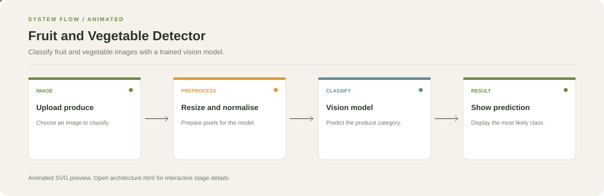

# Fruit and Vegetable Detector

**Classify fruit and vegetable images with a trained vision model.**

[](https://github.com/chyk2468/Fruit-Veg-Detector)

## 1. Project Title & Tagline

Classify fruit and vegetable images with a trained vision model.

## 2. Problem Statement

Recognising produce from images can be slow to do manually. This project demonstrates an image-classification workflow that predicts a fruit or vegetable category from an input image.

## 3. Project Preview

Add a real screenshot or short GIF showing the input, main controls, and resulting output.

[Open interactive architecture](architecture.html)

## 4. Overview

The application follows a clear input-to-output workflow. The exact model or processing behaviour depends on the current code and configuration in the repository.

## 5. Key Features

- Load an image for classification.
- Preprocess the image for model input.
- Predict a fruit or vegetable class.
- Display the predicted category in the app.

## 6. Architecture / Workflow



Open the [interactive architecture explorer](architecture.html) to select a stage and inspect its role.

## 7. Tech Stack

Python, TensorFlow or Keras, image-processing libraries, and the UI framework used in the repository

## 8. Installation & Setup

```bash
git clone https://github.com/chyk2468/Fruit-Veg-Detector.git
cd Fruit-Veg-Detector
python -m venv .venv
```

Activate the environment and install the repository dependencies.

## 9. Usage

Start the app using its documented entry point, upload a supported image, and inspect the predicted class. Use images similar to the training data when evaluating performance.

## 10. Project Structure

Inspect the app entry point, image preprocessing, model loading, class labels, and any training notebook.

## 11. Results & Demo

Add a sample image and its predicted class, plus test-set accuracy and per-class metrics if available. Do not report unmeasured accuracy.

## 12. Future Enhancements

- Add confidence display and top-k predictions.
- Test on varied lighting and camera conditions.
- Report a confusion matrix.
- Support batch inference.

## 13. License

Check the repository and model licence before redistributing weights or datasets.
