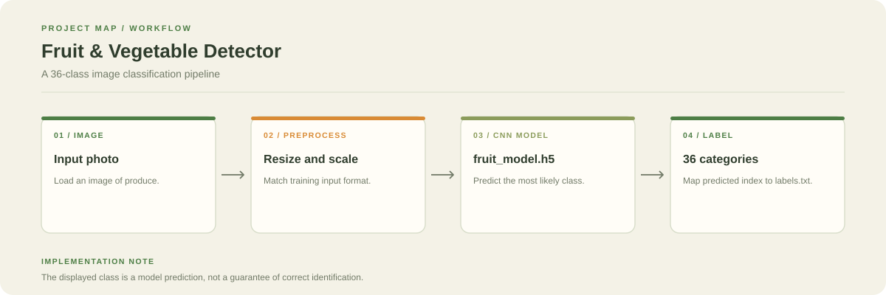

# Fruit & Vegetable Detector

A CNN image classifier for 36 fruit and vegetable categories, with a saved Keras model and notebooks for training and testing.

**Stack:** Python, TensorFlow/Keras, Jupyter Notebook



## What is included

- `fruit_model.h5`: trained model artefact
- `labels.txt`: class-name mapping
- `Training_fruit_vegetabble.ipynb`: training workflow
- `Test.ipynb`: testing workflow

## Inference workflow

1. Load an image and resize/normalise it to the model's expected input.
2. Run the image through the saved model.
3. Select the highest-scoring output.
4. Use `labels.txt` to map the output index to a class name.

## Run

```bash
git clone https://github.com/chyk2468/Fruit-Veg-Detector.git
cd Fruit-Veg-Detector
pip install tensorflow pillow numpy jupyter
jupyter notebook Test.ipynb
```

Use the preprocessing steps expected by the notebook and saved model. If you retrain the model, update the label order and model file together.

## Limitations

Results depend on image quality, lighting, produce variety, and the training dataset. Treat predictions as suggestions and inspect uncertain results.
